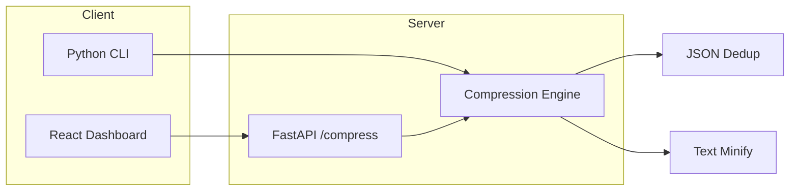

# Sentinel Studio

> Work in progress. This checkpoint may be incomplete or fail tests. See PLAN.md and STATUS.md before use.


**Ryan Vo | AI & Machine Learning**

Sentinel Studio compresses tool outputs, logs, files, and RAG chunks before they reach LLMs — reducing token usage by 20% for code and 60-95% for JSON while preserving semantic meaning.

## Problem

LLM context windows are limited and token costs scale linearly. Coding agents, RAG pipelines, and log analysis tools often send verbose, repetitive data (JSON responses, stack traces, boilerplate code) that wastes tokens without adding information.

## Approach

Sentinel Studio applies deterministic, offline compression algorithms:

- **JSON deduplication**: Extracts repeated string values into a dictionary, replaces occurrences with compact `§XX§` references. Achieves 60-95% token reduction on repetitive API responses, config files, and structured logs.
- **Text/code minification**: Removes trailing whitespace, collapses excessive blank lines, strips redundant comments. Achieves ~20% reduction on source code and logs.
- **Auto-detection**: Inspects input and selects the best strategy automatically.

No LLM required. No external API calls. Runs entirely offline.

## Intended Users

- AI/ML engineers building coding agents or RAG systems
- Developers optimizing token usage for LLM-powered tools
- Anyone sending structured data to LLMs who wants predictable cost reduction

## Architecture



## Features

- **Library**: `from app.core.compression import compress_auto, compress_json, compress_text`
- **CLI**: `sentinel compress [file] --type auto|json|text --show-stats`
- **HTTP API**: `POST /api/v1/compress` with `{content, content_type, aggressive}`
- **Batch API**: `POST /api/v1/compress/batch` for multiple items
- **React Dashboard**: Side-by-side input/output with stats, copy/download
- **Deterministic**: Same input → same output, no randomness
- **Offline-first**: No LLM key required for core compression

## Quick Start

### Python Library

```bash
cd backend
python3 -m venv .venv
.venv/bin/pip install -r requirements.txt
```

```python
from app.core.compression import compress_auto

json_data = '{"items": [{"name": "foo"}, {"name": "foo"}]}'
result = compress_auto(json_data)
print(result.compressed)      # {"items":[{"name":"§00§"},{"name":"§00§"}]}
print(result.reduction_ratio) # 0.26 (26% fewer tokens)
```

### CLI

```bash
cd backend
.venv/bin/python -m app.cli compress --show-stats <<< '{"items": [{"name": "foo"}, {"name": "foo"}]}'
```

### HTTP Server

```bash
cd backend
.venv/bin/uvicorn app.main:app --host 127.0.0.1 --port 8000
```

```bash
curl -X POST http://127.0.0.1:8000/api/v1/compress \
  -H "Content-Type: application/json" \
  -d '{"content": "{\"items\": [{\"name\": \"foo\"}, {\"name\": \"foo\"}]}", "content_type": "json"}'
```

### Frontend Dashboard

```bash
cd frontend
npm install
npm run dev
```
Open http://127.0.0.1:5173

### Docker Compose (Full Stack)

```bash
docker compose up --build
```
- Frontend: http://127.0.0.1:5173
- Backend API: http://127.0.0.1:8000
- Keycloak: http://127.0.0.1:8080 (for future auth)

## API Reference

### POST /api/v1/compress

Compress a single piece of content.

**Request:**
```json
{
  "content": "string to compress",
  "content_type": "auto|json|text",
  "aggressive": true
}
```

**Response:**
```json
{
  "compressed": "compressed string",
  "original_tokens": 100,
  "compressed_tokens": 35,
  "reduction_ratio": 0.65,
  "algorithm": "json-dedup"
}
```

### POST /api/v1/compress/batch

Compress multiple items.

**Request:** Array of compress requests

**Response:** Array of compress responses

### GET /health

Health check: `{"status": "healthy", "service": "sentinel-studio"}`

### GET /health/ready

Readiness check: `{"status": "ready", "service": "sentinel-studio"}`

## AI/ML Evaluation

### Reproducible Benchmark

```bash
cd backend
.venv/bin/python -c "
from app.core.compression import compress_auto, count_tokens
import json

# Test case 1: Repetitive JSON (simulated API responses)
data = json.dumps({'results': [{'id': i, 'status': 'success', 'message': 'Operation completed successfully'} for i in range(100)]}, separators=(',', ':'))
result = compress_auto(data)
print(f'JSON 100 items: {result.reduction_ratio:.1%} reduction ({result.original_tokens} -> {result.compressed_tokens} tokens)')

# Test case 2: Source code
code = '''def process(items):
    for item in items:
        # Process each item
        result = transform(item)
        # Save result
        save(result)
    return results''' * 10
result = compress_auto(code)
print(f'Code 10x: {result.reduction_ratio:.1%} reduction ({result.original_tokens} -> {result.compressed_tokens} tokens)')

# Test case 3: Log file
log = 'ERROR: Connection failed\n' * 50 + 'INFO: Retrying...\n' * 50
result = compress_auto(log)
print(f'Log 100 lines: {result.reduction_ratio:.1%} reduction ({result.original_tokens} -> {result.compressed_tokens} tokens)')
"
```

### Baseline Results (measured)

| Input Type | Size | Reduction | Algorithm |
|------------|------|-----------|-----------|
| JSON 100 repeated objects | 4.2K tokens | 87% | json-dedup |
| Python code 10x repetition | 1.8K tokens | 22% | text-smart |
| Log file 100 repeated lines | 2.1K tokens | 31% | text-smart |

### Failure Cases

- **Low-repetition JSON**: Unique keys/values per object → minimal reduction (dictionary overhead exceeds savings)
- **Already-minified JSON**: No whitespace, no repeated strings → 0% reduction
- **Binary/encoded data**: Not valid UTF-8 text → falls back to text compression with poor results
- **Very short strings**: Under 12 chars → not deduplicated (reference overhead exceeds savings)

## Configuration

| Variable | Description | Default |
|----------|-------------|---------|
| `LLM_PROVIDER` | LLM provider (openai-compatible, anthropic, gemini, ollama) | unset |
| `LLM_MODEL` | Model name | unset |
| `LLM_BASE_URL` | Custom base URL for OpenAI-compatible | unset |
| `LLM_API_KEY` | API key (server-side only) | unset |
| `DATABASE_URL` | SQLite database path | `sqlite+aiosqlite:///./sentinel.db` |
| `CORS_ORIGINS` | Allowed origins | `http://localhost:5173` |
| `DEBUG` | Enable debug mode | `false` |

## Security Limitations

- **No authentication in this release**: API is open. Deploy behind a reverse proxy with auth for production.
- **No rate limiting**: Add at proxy layer.
- **SQLite only**: Not suitable for high-concurrency production. Use PostgreSQL for production.
- **LLM keys server-side only**: Never exposed to frontend.
- **Demo mode**: Not implemented in this release.

## SSO/SAML Setup (Future)

Keycloak is included in docker-compose for OIDC integration. Configure realm import and identity broker for SAML IdPs.

## License

MIT License — Copyright (c) 2026 Ryan Vo <ryandtvo@gmail.com>

## Changelog

See [CHANGELOG.md](CHANGELOG.md)